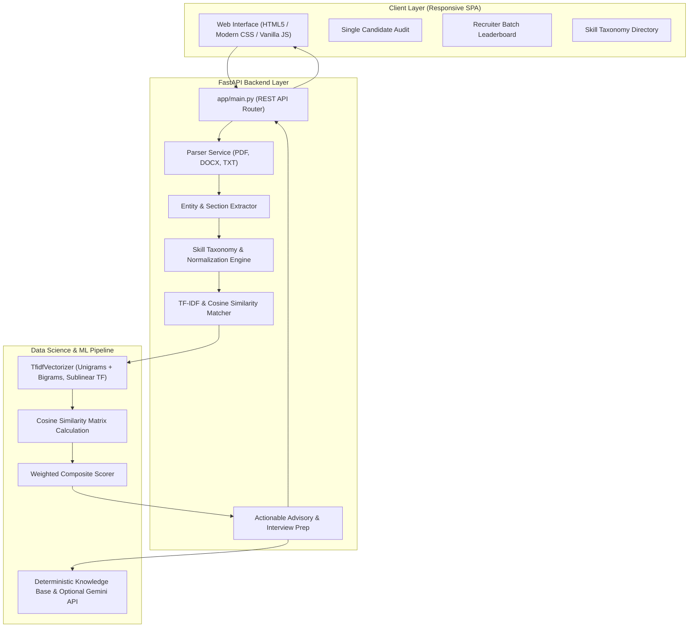

# AI Resume Analysis & Screening System

[](https://python.org)
[](https://fastapi.tiangolo.com)
[](https://scikit-learn.org)
[](LICENSE)
[]()

An intelligent, production-grade **Resume Analysis, ATS Compatibility Checker, and Recruiter Batch Screening System** engineered to automate technical talent evaluation. Built with **FastAPI**, **Scikit-Learn**, and natural language processing (NLP), this system bridges the gap between job candidates optimizing for ATS scanners and technical recruiters screening hundreds of resumes against complex job descriptions.

Developed by **[Pranali Wadtile](https://github.com/WadtilePranali)** (Final-Year B.Tech Data Science Engineering).

---

## 🌟 Key Features

### 1. In-Depth Candidate Resume Audit
- **Multi-Format Ingestion**: Parses `.pdf`, `.docx`, and `.txt` files with fallback text extraction mechanisms.
- **Section & Entity Extraction**: Automatically detects and extracts candidate name, email, phone number, LinkedIn/GitHub links, education degrees, and cumulative years of experience.
- **Composite Match Scoring (0–100%)**: Multi-factor weighted evaluation combining skill coverage, semantic similarity, experience level, and education tier.
- **Skill Gap Matrix**: Categorizes skills into **Matched Required Skills** (green), **Missing Required Skills** (red), and **Additional Candidate Strengths** (blue).
- **Actionable Optimization Plan**: Recommends concrete resume improvements and flags formatting risks.
- **Tailored Interview Prep**: Generates domain-specific technical interview questions based on matched skills.

### 2. High-Throughput Recruiter Screening Pipeline
- **Batch Processing**: Concurrently analyzes and scores 5 to 50+ candidate resumes against a single job description.
- **Ranked Leaderboard**: Automatically ranks candidates from strongest fit to lowest match with visual status badges (`Strong Fit`, `Moderate Fit`, `Potential Fit`, `Low Match`).
- **Applicant Pool Analytics**: Highlights top skill gaps across the entire applicant pool to identify broader talent market trends.
- **CSV Report Export**: Generates and downloads a clean, structured `.csv` screening report for downstream HR and ATS workflows.

### 3. Structural ATS Compliance Checker
- **7-Point Audit**:
  1. Header Contact Information (Email & Phone verification).
  2. Standard Section Headers (`Experience`, `Education`, `Skills`, `Projects`).
  3. Word Count Calibration (sweet spot: 350–1100 words).
  4. Impactful Action Verbs density (`Engineered`, `Deployed`, `Architected`, etc.).
  5. Quantifiable Achievements check (percentages, metrics, scale indicators).
  6. Document parseability & layout compatibility.
  7. Clear visual impact tags (`PASS`, `WARNING`, `FAIL`).

### 4. Normalized Engineering Skill Taxonomy (600+ Skills)
- Domain-categorized taxonomy covering:
  - **Data Science & Machine Learning** (PyTorch, Scikit-Learn, TensorFlow, NLP, LLMs, Pandas, MLOps)
  - **Programming Languages** (Python, SQL, C++, Java, TypeScript, Go)
  - **Big Data & Databases** (PostgreSQL, MongoDB, Redis, Apache Spark, Kafka)
  - **Cloud & DevOps** (AWS, GCP, Azure, Docker, Kubernetes, CI/CD)
  - **Web Frameworks & APIs** (FastAPI, Flask, Django, React, REST APIs)
  - **Software Engineering & Tools** (Git, Pytest, Agile/Scrum, Microservices)
  - **Soft Skills & Leadership**
- **Synonym & Alias Normalization**: Employs boundary-sensitive regex mapping (e.g., `sklearn` $\rightarrow$ `Scikit-Learn`, `tf` $\rightarrow$ `TensorFlow`, `k8s` $\rightarrow$ `Kubernetes`, `js` $\rightarrow$ `JavaScript`) to eliminate false negatives.

---

## 📐 Architecture & System Design



---

## 🧮 Mathematical Scoring Methodology

The overall match score is calculated using a multi-factor weighted equation:

$$\text{Overall Fit Score} = (w_{\text{skills}} \cdot S_{\text{skills}}) + (w_{\text{semantic}} \cdot S_{\text{semantic}}) + (w_{\text{exp}} \cdot S_{\text{exp}}) + (w_{\text{edu}} \cdot S_{\text{edu}})$$

Where default weights are:
- $w_{\text{skills}} = 0.40$ (Skill Coverage Ratio: $\frac{|\text{Resume Skills} \cap \text{JD Skills}|}{|\text{JD Skills}|} \times 100$)
- $w_{\text{semantic}} = 0.35$ (TF-IDF Cosine Similarity across unigrams and bigrams)
- $w_{\text{exp}} = 0.15$ (Years of Experience Alignment: $\min(100, \frac{\text{Exp}_{\text{candidate}}}{\text{Exp}_{\text{required}}} \times 100)$)
- $w_{\text{edu}} = 0.10$ (Hierarchical Degree Alignment: Doctorate > Master's > Bachelor's > Diploma)

$$\sum w_i = 1.0$$

---

## 🛠️ Technology Stack

| Layer | Technology | Purpose |
|---|---|---|
| **Backend Framework** | **FastAPI** (Python 3.11) | High-performance asynchronous REST API architecture |
| **Server Engine** | **Uvicorn** | ASGI server for production deployment |
| **Machine Learning / NLP** | **Scikit-Learn** (`TfidfVectorizer`, `cosine_similarity`) | Sublinear TF-IDF vectorization and semantic distance computation |
| **Document Parsing** | **pypdf**, **python-docx** | Robust multi-page PDF & Word table extraction |
| **Data Validation** | **Pydantic v2** | Strict input/output schema validation and typing |
| **Frontend** | **HTML5, Modern CSS, ES6 JS** | Accessible, responsive Single Page Application (zero bloated node dependencies) |
| **Testing** | **Pytest**, **Pytest-Asyncio** | Automated unit and integration test suite |
| **AI Integration** | **Deterministic Local Engine + Optional Google Gemini** | Zero-dependency offline operation with optional LLM enhancement |

---

## 📁 Repository Structure

```
AI Resume Analysis & Screening System/
├── .env.example              # Environment variables template
├── .gitignore                # Production Git ignore rules
├── README.md                 # Complete project documentation
├── requirements.txt          # Python package dependencies
├── run.py                    # One-command server runner
├── app/
│   ├── __init__.py
│   ├── main.py               # FastAPI application, routes, and static mounts
│   ├── config.py             # App configurations, weights, and file limits
│   ├── models/
│   │   ├── __init__.py
│   │   └── schemas.py        # Pydantic schemas for requests and responses
│   ├── services/
│   │   ├── __init__.py
│   │   ├── parser.py         # Multi-format document parser (PDF, DOCX, TXT)
│   │   ├── extractor.py      # Entity, contact, experience, and ATS extraction
│   │   ├── skill_taxonomy.py # 600+ skills categorized with synonym mappings
│   │   ├── matcher.py        # TF-IDF, Cosine Similarity, and Composite Scorer
│   │   └── advisor.py        # Actionable recommendations & interview questions
│   ├── samples/
│   │   ├── __init__.py
│   │   └── sample_data.py    # Benchmark JDs and realistic candidate resumes
│   └── static/
│       ├── index.html        # Clean, modern single page application
│       ├── css/
│       │   └── styles.css    # Restrained, accessible product UI design
│       └── js/
│           └── app.js        # Interactive tabs, file dropzone, CSV export
└── tests/
    ├── __init__.py
    ├── test_parser.py        # Unit tests for document parsing
    ├── test_extractor.py     # Unit tests for contact and ATS evaluation
    ├── test_matcher.py       # Unit tests for TF-IDF and skill matching
    └── test_api.py           # Integration tests for FastAPI endpoints
```

---

## 🚀 Quickstart & Installation

### 1. Prerequisites
- Python 3.10 or 3.11 installed.
- Git installed.

### 2. Clone Repository
```bash
git clone https://github.com/WadtilePranali/AI-Resume-Analysis-Screening-System.git
cd "AI-Resume-Analysis-Screening-System"
```

### 3. Create & Activate Virtual Environment
```bash
# Windows
python -m venv venv
venv\Scripts\activate

# macOS / Linux
python3 -m venv venv
source venv/bin/activate
```

### 4. Install Dependencies
```bash
pip install -r requirements.txt
```

### 5. Configure Environment Variables (Optional)
```bash
cp .env.example .env
```
> **Note**: The system works **100% offline** out of the box using local Scikit-Learn and regex heuristics without needing any paid API keys. If you want Google Gemini-powered personalized interview questions, add your key to `GEMINI_API_KEY` in `.env`.

### 6. Launch Application
```bash
python run.py
```
Open your browser and navigate to: **`http://127.0.0.1:8000`**

Interactive OpenAPI Documentation: **`http://127.0.0.1:8000/docs`**

---

## 🧪 Running Automated Tests

Run the full test suite with verbose output:

```bash
python -m pytest -v
```

### Verified Test Results:
```text
============================= test session starts =============================
platform win32 -- Python 3.11.9, pytest-9.1.1
collected 16 items

tests/test_api.py::test_api_health PASSED                                [  6%]
tests/test_api.py::test_api_samples PASSED                               [ 12%]
tests/test_api.py::test_api_skills_taxonomy PASSED                       [ 18%]
tests/test_api.py::test_process_single_audit PASSED                      [ 25%]
tests/test_api.py::test_screen_batch_sample PASSED                       [ 31%]
tests/test_extractor.py::test_extract_contact_info PASSED                [ 37%]
tests/test_extractor.py::test_extract_education_level PASSED             [ 43%]
tests/test_extractor.py::test_extract_experience_years PASSED            [ 50%]
tests/test_extractor.py::test_audit_ats_compatibility PASSED             [ 56%]
tests/test_matcher.py::test_extract_skills PASSED                        [ 62%]
tests/test_matcher.py::test_calculate_tfidf_similarity PASSED            [ 68%]
tests/test_matcher.py::test_calculate_skill_match PASSED                 [ 75%]
tests/test_matcher.py::test_composite_score PASSED                       [ 81%]
tests/test_parser.py::test_parse_txt_document PASSED                     [ 87%]
tests/test_parser.py::test_parse_invalid_extension PASSED                [ 93%]
tests/test_parser.py::test_segment_resume_sections PASSED                [100%]

============================= 16 passed in 5.30s ==============================
```

---

## 📡 API Endpoints Reference

| Method | Endpoint | Description |
|---|---|---|
| `GET` | `/api/health` | Returns backend health, version, and active AI engine mode |
| `GET` | `/api/samples` | Returns benchmark Job Descriptions and Candidate Resumes |
| `GET` | `/api/skills/taxonomy` | Returns full categorized skill taxonomy with tracked count |
| `POST` | `/api/analyze/text` | Analyzes candidate resume vs JD from raw form text |
| `POST` | `/api/analyze/upload` | Ingests `.pdf`, `.docx`, or `.txt` resume file and screens vs JD |
| `POST` | `/api/screen-batch` | High-throughput batch screening of multiple candidate resumes |
| `POST` | `/api/screen-batch/sample` | Runs 1-click batch screening on built-in candidate pool |
| `GET` | `/` | Serves the Single Page Application interface |

---

## 🎓 Technical Interview Talking Points (For Data Science Interviews)

When defending this project in engineering and data science interviews:

1. **Why Hybrid Scoring instead of pure Cosine Similarity?**
   - *Answer*: Pure TF-IDF cosine similarity suffers when candidates use concise phrasing or different formatting. A hybrid model ensures that hard technical skills ($40\%$), semantic content ($35\%$), years of experience ($15\%$), and degree level ($10\%$) are balanced, reflecting real-world hiring decisions.
2. **How does the system prevent synonym mismatches?**
   - *Answer*: We implemented a normalized skill taxonomy of 600+ engineering skills with alias mapping (e.g., `sklearn` $\rightarrow$ `Scikit-Learn`, `NLP` $\rightarrow$ `Natural Language Processing`). Word-boundary regex prevents substring false-positives (e.g., preventing `C` from matching inside `CSS` or `Cloud`).
3. **How does the system scale for recruiter batch processing?**
   - *Answer*: Document extraction and vector computations are handled in parallel in worker threads. Vectorization utilizes sublinear term frequency scaling ($1 + \log(\text{tf})$) to avoid keyword stuffing bias.
4. **Offline Resilience**:
   - *Answer*: The entire screening core is self-contained without requiring external cloud APIs. It falls back gracefully to a deterministic rule-based advisory engine, ensuring 100% availability.

---

## 📄 License

This project is licensed under the MIT License - see the [LICENSE](LICENSE) file for details.

---

## 👩‍💻 Author

**Pranali Wadtile**
- Final-Year B.Tech Data Science Engineering Student
- GitHub: [@WadtilePranali](https://github.com/WadtilePranali)
- LinkedIn: [Pranali Wadtile](https://linkedin.com/in/pranali-wadtile)
